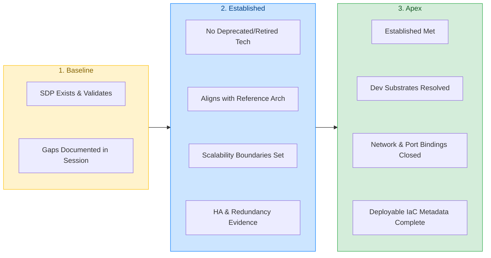

# Sofa King DRAFT Architecture Maturity Rubric

This document defines the Sofa King-specific architecture maturity levels for engineering teams putting their products into DRAFT. It provides the **Draftsman AI** with a structured, step-by-step rubric to score any Software Deployment Pattern (SDP) and identify concrete gaps.



---

## Maturity Levels & Criteria

### 1. Baseline Maturity
*Goal: The system is transparently documented in DRAFT, and all known "unknowns" are explicitly tracked.*

*   **SDP Integrity**: A valid Software Deployment Pattern (`type: software_deployment_pattern`) exists in the correct `catalog/` path matching the team's ownership.
*   **Schema Compliance**: The SDP and all its immediate child objects pass the core DRAFT validator without syntax or schema errors (`validate.py` returns no blocking failures).
*   **Explicit Uncertainty**: Any missing, legacy, or unconfirmed infrastructure pieces are not left blank; they are formally declared in an active `drafting_session` object or listed as unresolved questions in the catalog.

---

### 2. Established Maturity
*Goal: The system is designed to Sofa King's architectural standards, uses approved tech stacks, and is operationally resilient.*

*   **Technology Compliance**: All referenced Technology Components (`type: technology_component`) in the SDP's active graph are mapped to `preferred` or `candidate` capability implementations. No `deprecated` or `retired` technology is present in the architecture.
*   **Pattern Alignment**: The SDP explicitly references and aligns with an approved **Reference Architecture** pattern, OR has a formally approved architectural deviation documented via an associated **Decision Record** (`type: decision_record`).
*   **Scalability Boundaries**: Each Product Service group within the SDP defines its operational scaling boundaries (e.g., ingress limits, memory/CPU bounds, and replication bounds).
*   **High Availability (H/A) Evidence**:
    *   Hosts are configured across multiple Availability Zones (AZs) or failover domains.
    *   Redundancy topologies are documented for all Runtime and Data Store Services.
    *   Durable Data Store Services have an explicitly defined and mapped `Backup Strategy` capability.

---

### 3. Apex Maturity
*Goal: The architecture is fully resolved, closed, and contains enough detail to compile directly into a working Dev environment.*

*   **Established Pre-requisites**: Meets 100% of the criteria for both **Baseline** and **Established** levels.
*   **Substrate Resolution**: All deployable services (`Product Service`, `Runtime Service`, `Data Store Service`) have their executing substrates (`runsOn` or `host`) fully resolved to an approved company Host Standard. No generic hosting placeholders are used.
*   **Environment Mapping**: The SDP assigns explicit environment tier details (`environment_tier`) for the target Dev environment.
*   **Closed Network Topology**:
    *   **Network Zones**: All services are explicitly assigned to standard network zones (e.g., public, private, utility).
    *   **Network Bindings**: Service-to-service connections and external interactions are fully closed with explicit port definitions, protocols, and outbound/inbound directionality.
*   **Secret & Configuration Mediation**: Secrets management, configuration management, and database credential delivery mechanisms are fully mapped to active secret store Technology Components.

---

## Draftsman Scoring Guide

When a product team invokes `/draftsman` or asks you to **"Score my SDP against the architecture maturity rubric,"** execute the following five-phase evaluation procedure:

### Phase 1 — Validate & Verify (Baseline Check)
1. Run schema validation on the targeted SDP.
2. Check if all unresolved questions, missing hosts, or uncertain components are documented in a `drafting_session`.
3. **Score Baseline**: **Pass** if valid and gaps are documented; **Fail** if invalid or has silent unmapped fields.

### Phase 2 — Evaluate Technology & Resilience (Established Check)
1. Walk the SDP's dependency graph. Check each `Technology Component`:
   - Resolve its Capability mapping.
   - Verify `lifecycleStatus` is NOT `deprecated` or `retired`.
2. Inspect `referenceArchitecture` or associated `decision_records` for pattern alignment.
3. Check `Data Store Services` for:
   - Mapped `Backup Strategy` capabilities.
   - Uptime/replication topologies (H/A evidence).
4. **Score Established**: **Pass** if all conditions are met; otherwise, report the exact list of non-compliant components or missing H/A evidence.

### Phase 3 — Resolve Substrates & Connectivity (Apex Check)
1. Verify if every self-managed runtime service resolves `runsOn` to a specific, approved Host Standard.
2. Audit the connection graph:
   - Ensure every `serviceConnection` has a defined `port` and `protocol`.
   - Verify all network zone mappings are closed.
3. **Score Apex**: **Pass** if the architecture is ready to be compiled to IaC/manifests; otherwise, list the missing deployment fields.

### Phase 4 — Generate Maturity Report
Render a clean, professional scorecard using the following structure:

```markdown
## DRAFT Architecture Maturity Scorecard: [Product Name]

### 📊 Overall Maturity: [Baseline | Established | Apex]

| Level | Status | Core Gaps / Action Items |
| :--- | :--- | :--- |
| **Baseline** | [✅ Pass / ❌ Fail] | *e.g., 2 schema warnings found.* |
| **Established**| [✅ Pass / ❌ Fail] | *e.g., Uses 'MariaDB 10.5' (Deprecated).* |
| **Apex** | [✅ Pass / ❌ Fail] | *e.g., Network bindings missing ports.* |

---

### 🔍 Detailed Findings & Remediation Steps

#### 1. Baseline Level
* [ ] ...

#### 2. Established Level
* [ ] ...

#### 3. Apex Level
* [ ] ...

---

### 🏁 Architecture Maturity Score: [0 | 1 | 2 | 3]

> **Use this score when filling out your Apex scorecard for Turn 1 Architecture.**
```

**Score mapping:**
- **0** — Below Baseline (Baseline criteria not met)
- **1** — Baseline (Baseline met; Established not yet met)
- **2** — Established (Baseline + Established met; Apex not yet met)
- **3** — Apex (all levels met)

---

> [!NOTE]
> This rubric is a custom Sofa King extension. It works in conjunction with standard DRAFT framework validation rules to drive continuous architecture delivery.
